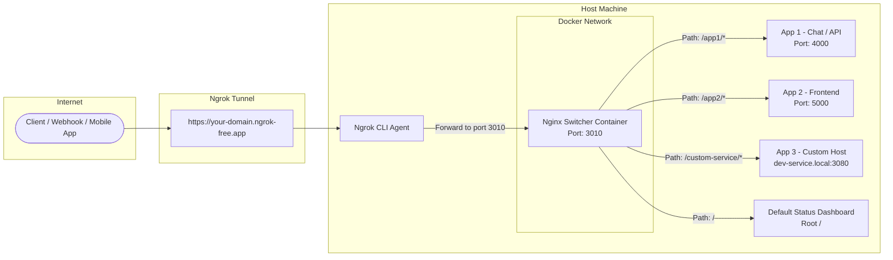

# Ngrok + Nginx Multi-Service Switcher

[](https://www.docker.com/)
[](https://nginx.org/)
[](https://ngrok.com/)
[](LICENSE)

A generic, production-ready template to expose **multiple local applications, microservices, and APIs** through a **single Ngrok public domain/endpoint** using path-based routing (`/app1`, `/app2`, `/api`) powered by a lightweight **Dockerized Nginx reverse proxy**.

---

## 💡 The Problem & The Solution

- **The Problem:** Ngrok free and basic tiers provide a single static or dynamic domain. If you are developing 3 or 4 separate services locally (e.g. Frontend, Admin Dashboard, Chat Server, Webhook API), exposing all of them typically requires multiple paid Ngrok tunnels or juggling tunnel URLs.
- **The Solution:** Point your single Ngrok tunnel to this **Nginx Switcher**. Nginx inspects the request path and transparently routes the traffic to whichever local port or internal hostname is running that service.

---

## 🏛 Architecture



---

## 📁 Project Structure

```text
ngrok-nginx-docker/
├── .env.example              # Template for environment configuration
├── .gitignore                # Protects secrets, tokens, and logs
├── docker-compose.yml        # Docker Compose service definition
├── LICENSE                   # MIT License
├── README.md                 # Project documentation
├── nginx/
│   ├── nginx.conf            # Switcher reverse proxy rules & patterns
│   └── html/
│       └── index.html        # Default status dashboard for root '/'
├── ngrok/
│   ├── ngrok.example.yml     # Ngrok v3 configuration template
│   └── README.md             # Ngrok setup & OS paths guide
└── scripts/
    ├── start-all.bat         # One-click launcher for Windows (Docker + Ngrok)
    ├── start-ngrok.bat       # Windows launcher for Ngrok
    └── start-ngrok.sh        # Linux / macOS launcher for Ngrok
```

---

## 🚀 Quick Start

### 1. Prerequisites
- [Docker](https://www.docker.com/products/docker-desktop/) (Docker Desktop on Windows/macOS or Docker Engine + Compose plugin on Linux).
- [Ngrok CLI](https://ngrok.com/download) installed and authenticated.

### 2. Configure Environment
Copy the example environment file and customize your values:
```bash
cp .env.example .env
```
Inside `.env`:
```env
SWITCHER_PORT=3010
LOCAL_HOST_IP=host-gateway
NGROK_ENDPOINT_NAME=my-switcher-endpoint
```

### 3. Configure Ngrok (v3)
Add an endpoint definition to your Ngrok configuration file (refer to [ngrok/README.md](file:///ngrok/README.md) for OS paths):
```yaml
version: "3"
agent:
  authtoken: YOUR_NGROK_AUTHTOKEN

endpoints:
  - name: my-switcher-endpoint
    url: https://YOUR-SUBDOMAIN.ngrok-free.app
    upstream:
      url: 3010
```

### 4. Start the Services

#### Option A: Quick Launch (Windows)
Double-click or run:
```cmd
scripts\start-all.bat
```

#### Option B: Manual Launch
1. **Start Nginx Switcher with Docker Compose:**
   ```bash
   docker compose up -d
   ```
2. **Start the Ngrok tunnel:**
   - **Windows:**
     ```cmd
     scripts\start-ngrok.bat
     ```
   - **Linux / macOS:**
     ```bash
     chmod +x scripts/start-ngrok.sh
     ./scripts/start-ngrok.sh
     ```

### 5. Verify
Open your browser and navigate to:
- `https://YOUR-SUBDOMAIN.ngrok-free.app/` &rarr; You will see the **Switcher Status Page**.
- `https://YOUR-SUBDOMAIN.ngrok-free.app/app1/` &rarr; Routed to service 1.
- `https://YOUR-SUBDOMAIN.ngrok-free.app/app2` &rarr; Routed to service 2.

---

## 🛠 Routing Patterns & How to Add Services

Edit [nginx/nginx.conf](file:///nginx/nginx.conf) to register your routes. Common patterns are pre-configured:

### Pattern 1: Strip Subpath (e.g. `/app1/*` &rarr; `http://host.docker.internal:4000/*`)
Use this when your local app does not know it is hosted under `/app1/` and expects requests at `/`:
```nginx
# 1. Trailing slash redirect (ensures relative assets load correctly)
location = /app1 {
    return 301 $scheme://$http_host$uri/;
}

# 2. Proxy pass with trailing slash (strips /app1/)
location /app1/ {
    proxy_pass http://host.docker.internal:4000/;
}
```

### Pattern 2: Preserve Subpath (e.g. `/app2` &rarr; `http://host.docker.internal:5000/app2`)
Use this when the application or API is designed to listen explicitly under `/app2`:
```nginx
location /app2 {
    proxy_pass http://host.docker.internal:5000;
}
```

### Pattern 3: Route to Custom Hostnames (defined in `extra_hosts`)
If your local setup uses virtual hostnames (e.g. `dev-service.local`):
1. Add the domain to `extra_hosts` in [docker-compose.yml](file:///docker-compose.yml):
   ```yaml
   extra_hosts:
     - "dev-service.local:host-gateway"
   ```
2. In [nginx/nginx.conf](file:///nginx/nginx.conf):
   ```nginx
   location /custom-service/ {
       proxy_pass http://dev-service.local:3080/;
   }
   ```

---

## ⚡ Key Best Practices Included

- **WebSocket / SSE Ready:** Configured with `Upgrade` and `Connection` maps so live-reload (Vite, Next.js) and WebSockets (Socket.io, Chat engines) work out of the box.
- **Trailing Slash 301 Fix:** Prevents the notorious 404 error where relative frontend assets (`./assets/app.js`) fail to load under reverse proxy subpaths.
- **Cross-Platform Host Gateway:** Uses Docker's `host.docker.internal:host-gateway` to communicate from inside the container back to host machine services seamlessly on Windows, macOS, and modern Linux.
- **Favicon 204 Optimization:** Silences noisy favicon 404 errors in container logs.

---

## 🛑 Stopping the Services

To stop the Nginx container:
```bash
docker compose down
```
To stop Ngrok, press `Ctrl + C` in the Ngrok terminal window.

---

## 📄 License
This project is open source and available under the [MIT License](file:///LICENSE).
